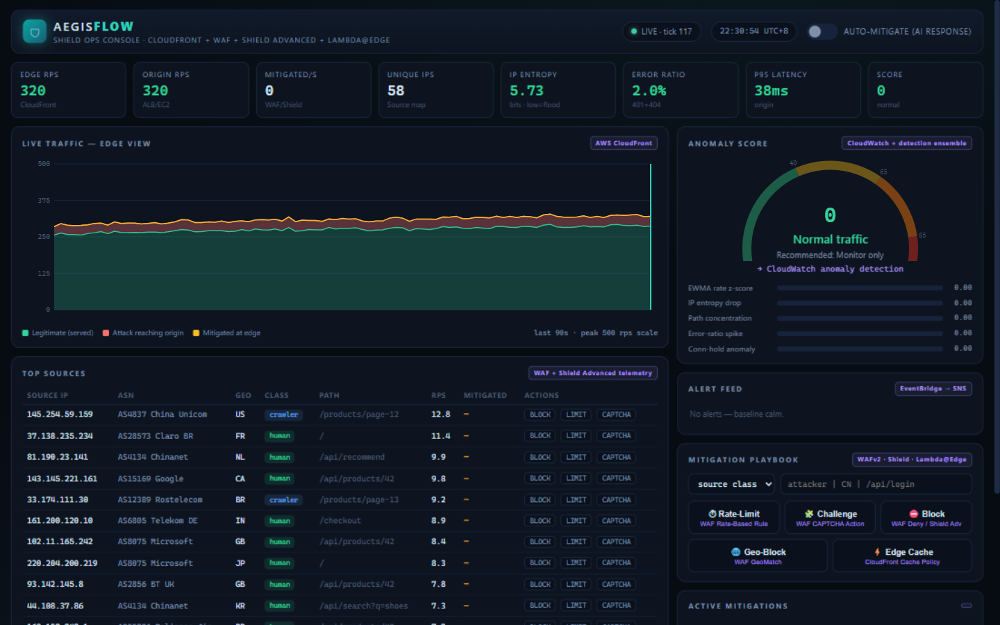
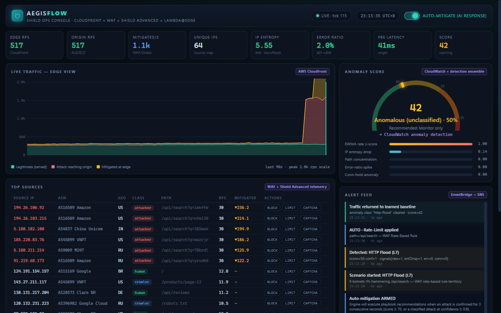
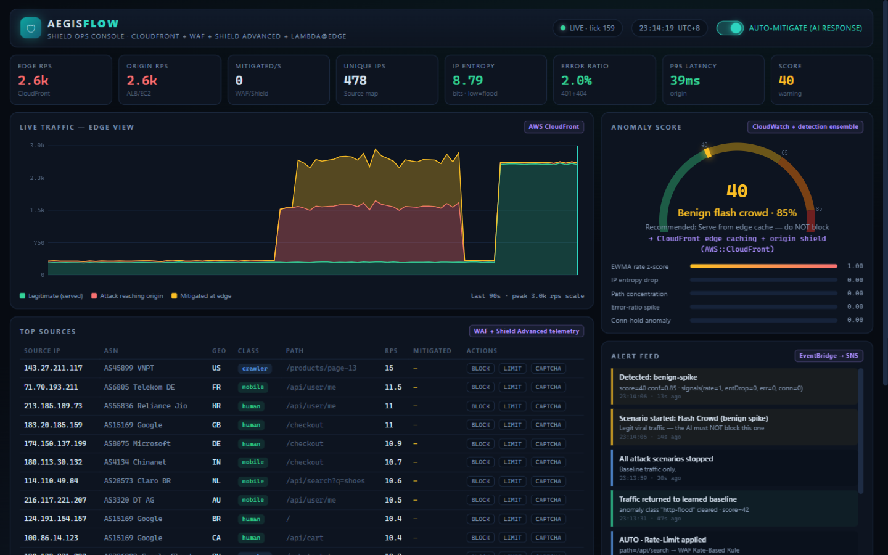

# AegisFlow — Shield Ops Console

> **Team Alpha · AWS x A10 Hack 2026** ("Shield with A10")

An AI-driven traffic anomaly detection & DDoS mitigation operations console. A live traffic
simulator feeds a multi-signal detection engine (EWMA residual + Shannon entropy of sources
and paths + error ratio + hold-time analysis); the console classifies attacks in real time
(HTTP flood, volumetric, slowloris, credential stuffing — and *benign spikes*, so the judge
can see it avoids false positives), and applies mitigation playbooks whose effect on origin
load is visible immediately.

  

## Screenshots

**Baseline — calm, calibrated** (score 0, entropy healthy, no alerts):



**Autopilot in action** — HTTP flood detected (conf=1.0) → rate-limit applied automatically →
attackers capped at 30 rps each (▼ counters), origin offloaded, p95 recovered (41 ms):



**The trust moment** — a 2.6k-rps benign flash crowd (478 unique IPs, autopilot still ARMED)
is classified benign at 85% confidence: *serve from edge cache, do NOT block*. Zero mitigations:



## Problem

When an L7 flood hits, the questions that matter are: *what kind of attack is this, which
playbook do I run, and is it actually working?* Most dashboards show traffic graphs but not
a decision loop. AegisFlow closes the loop: **detect → classify → recommend → mitigate → verify**,
on one screen, in one second ticks.

## What it does

- **Live traffic simulator** — human-ish baseline (~40 IPs, page mix, sessions) plus five
  injectable scenarios: `http-flood`, `volumetric`, `slowloris`, `credential-stuffing`,
  and `benign-spike` (a flash-crowd that must NOT be auto-blocked — the anti-false-positive demo).
- **Detection engine** (`lib/engine.js`, pure JS): per-tick KPIs (rps, unique IPs, source/path
  entropy, error ratio, avg hold, p95), EWMA baseline with variance tracking, and a weighted
  anomaly score. Classifies the attack class and assigns a playbook.
- **Mitigation playbooks** — `rate-limit` (per-path/IP threshold), `challenge` (JS interstitial),
  `block` (IP/ASN/geo/kind), `cache` (absorb GET floods at edge). Applying one immediately
  changes the numbers: raw rps vs origin rps split, dropped counters, p95 recovery.
- **Autopilot** — when anomaly score ≥ 70 for consecutive ticks, the recommended playbook is
  applied automatically and every action is logged to an audit trail.
- **SSE realtime** — dashboard updates via Server-Sent Events, 1 Hz, no polling libraries.

## Architecture

```
 browser ◄──SSE 1Hz── Node server (server.js, zero deps)
   │                    ├── /api/scenario   start/stop attack scenarios
   │                    ├── /api/mitigation add/remove/clear playbook rules
   │                    ├── /api/auto       autopilot on/off
   │                    └── lib/engine.js   simulator + detector + mitigation engine
   └── dashboard (public/index.html): ops console, canvas charts, alert feed, audit log

 USE_AWS=1 → lib/aws-adapter.js routes every mitigation to real AWS (WAFv2 rate-based
             rules, IP sets, CloudFront cache policies) with API-level payload builders
             + local replay verification (dispatches are checked against rule-name schemas).
```

## AWS services used (and why)

| Service | Role |
|---|---|
| **CloudFront** | edge absorption — `cache` playbook maps to cache policies; origin rps vs raw rps is exactly the CloudFront→origin ratio |
| **WAFv2** | `rate-limit` → RateBasedStatement; `block` → IPSet/GeoMatch/ByteMatch rules; `challenge` → CAPTCHA/Challenge action |
| **Shield Advanced** | volumetric layer; the volumetric scenario simulates what Shield absorbs before WAF sees it |
| **Lambda@Edge / CloudFront Functions** | challenge interstitial + per-request scoring at the edge |
| **CloudWatch** | the KPI stream (rps, entropy, p95, error ratio) maps 1:1 to custom metrics + alarms |

`aws-adapter.js` builds real WAFv2 API payloads (CreateRule / UpdateIPSet / CreateWebACL
shapes) locally so the code path is auditable without credentials; see
`aws/ARCHITECTURE.md` + `aws/template.yaml` (deployable SAM: CloudFront + WAF + Shield +
Functions + dashboard bucket).

## Run it

```bash
node server.js        # → http://localhost:8080  (no npm install, no credentials)
npm test              # 10 engine regression tests (node:test, zero deps)
# USE_AWS=1 node server.js   # same UI, mitigation dispatcher targets real AWS WAFv2
```

Then: start `http-flood`, watch the score climb past 70, hit **Autopilot** or apply the
recommended playbook manually, and watch origin rps collapse. Try `benign-spike` with
autopilot on: it classifies as *not* an attack and no customers get blocked.
Offline walkthrough: open `demo/index.html`.

## What's mocked vs real

- **Real, runs now:** simulator, full detection/classification math, playbook engine with
  measurable origin-offload, autopilot decision loop, SSE dashboard, WAFv2 payload builders.
- **Mocked:** the network itself (deterministic synthetic traffic). In AWS mode the same
  playbook specs are what the included SAM stack runs for real at the edge.

## Limitations

- Single-process simulation; the detector design (EWMA + entropy, 1 s windows) is the part
  that ports to Lambda@Edge, not the simulator.
- Geo/ASN scopes operate on synthetic metadata.
